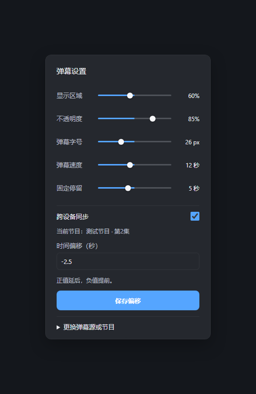
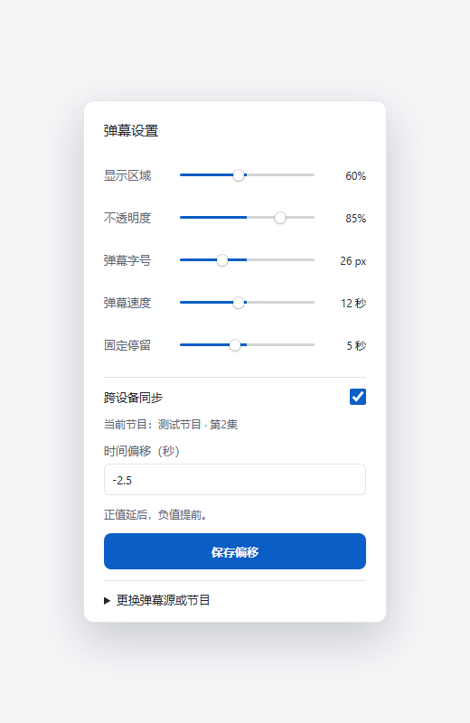

# Windows 播放器本地弹幕

当前播放流程为作品上下文 → 随播放器打包的本地源模块 → 源站 → 本机缓存与清洗 → 现有 CEF 绘制。弹幕设置提供“跨设备同步”开关，默认开启。仅在开启且 MSG 声明 `danmaku-associations` v1 时读写账号关联，保存源、节目页面 URL 与偏移。同账号另一台设备下次播放同一物理版本时复用该记录，不同步弹幕正文，也不实时推送正在播放的偏移。

关闭同步或服务端尚未声明能力时，使用标准媒体详情进行本地匹配，不请求账号弹幕接口。选源与偏移保存在播放器用户配置目录的 `danmaku-associations/`，按服务地址、账号与物理媒体版本隔离；重新播放或重启后仍可复用。界面明确显示“已保存至本机”或“已同步至此账号”。开启同步后服务端声明能力却返回错误时明确报告，不把同步失败伪装为保存成功。

已移除旧集中弹幕 API 的客户端调用和数字节目编号映射依赖。源站请求来自本机，不经过 MSG；本地模块通过 stdin/stdout 工作，不监听端口，不接收 MSG 凭据或媒体直链。源模块及运行时自动随标准构建和安装复制，用户无需另装 Node.js 或额外服务。模块与上游来源、许可证和重建说明见 `resources/danmaku/README.md`。

弹幕设置直接显示当前匹配节目与 ±600 秒时间偏移，“保存偏移”只修改当前关联，无需搜索。需要更换时才展开“更换弹幕源或节目”，按名称搜索腾讯视频、爱奇艺或优酷，点选节目与集数；页面地址由程序内部保存，无需用户填写。搜索中的选择不影响当前节目的偏移，更换节目时偏移从零开始。同步保存使用服务端修订号防止跨设备旧设置覆盖新设置；本机保存也检查当前任务和修订号，旧任务不能覆盖新选择。缺少准确元数据、多个候选、源请求失败或同步失败会明确提示；不会用空数组掩盖失败，也不会在已选源失败时自动改源。切集、切换同步开关、关闭弹幕或退出播放会取消仍在运行的本地源进程。

本轮未改动 TV 客户端，也未接入 Web 浏览器的本地源模块；MSG 的旧集中弹幕路由已在配套变更中退役。配套 MSG 源码为 `074d6a6891273bf27d9b040620f737060ba0eeaa`，镜像由 GitHub Actions run `39750331056` 构建，实际生产状态以 `/opt/deploy/media-stack/release.yml` 为准。未声明新能力的服务端仍可使用播放器本地弹幕。双设备实播未验证。

2026-10-22 已发布上述 MSG 镜像 `sha256:c0ba2c709418f773307e3cc9e7b27926287904fac94f68d11ebe69a43544bd7f`。临时 PostgreSQL 16 隔离验证包含读写、账号及物理版本隔离、409 冲突、认证及 URL 校验；生产只对真实媒体执行认证 GET，根路径和 `/emby` 均返回 200，未写媒体偏好或请求弹幕源。直接回滚保留发布前的 `faa1332afa9a682869ace94089fc8dfda8f343fd` 镜像。

## 本地验证（2026-10-22）

- `resources/danmaku` 中 `npm test`：8 个离线用例通过，覆盖直接 URL、整季搜索缓存、手动候选搜索、风控冷却、源错误、歧义匹配、清洗和校验。
- 随包 `build/danmaku/node.exe` 与 `worker.cjs` 在本机执行真实腾讯源搜索“三体”，得到 3 个节目、67 个分集；对精确标题的一集取得 51,077 条有效弹幕，均匀取样后返回 6,000 条。请求不经过 MSG，临时探针缓存已清理；本项未验证爱奇艺、优酷或 CEF 实播绘制。
- `cargo test --manifest-path src/Cargo.toml -p jfn-mediastation`：78 个用例通过，包含同步关闭、能力缺失、剧集作品信息和已声明能力却返回 404 的边界检查。
- `cargo test --manifest-path src/Cargo.toml -p jfn-mediastation local_danmaku::tests -- --ignored`：2 个随包进程测试通过，覆盖真实打包模块读缓存与偏移、取消回收、启动错误诊断；没有真实源站请求。
- `node dev/windows/test_local_danmaku_ui.cjs`、既有 `test_modern_cinema_ui.cjs` 通过，验证同步开关持久化和原生调用、本机与同步保存反馈、偏移直接保存、搜索草稿与当前关联独立、节目与集数选择、共享修订号与当前播放绑定、输入校验、清除过期关联及原播放器交互回归。
- `cargo test --manifest-path src/Cargo.toml -p jfn-cef danmaku`：5 个用例通过，覆盖原生接口、设置面板和本机文件持久化、账号及物理版本隔离、损坏或写入失败明确报错。
- 标准 `cargo xtask build --external-mpv $env:EXTERNAL_MPV_DIR` 已完成，产物为 `build/jellium-desktop.exe` 及旁边的 `build/danmaku/`。本路径下的 CEF debug 编译曾触发 C1083 长路径错误，使用现有短路径 `D:/codex-target/jellium` 编译缓存后通过，输出仍为标准 `build/`。
- 严格 Clippy 受既有 mpv 裸指针接口、runtime 中 expect 和冗余闭包告警阻塞；没有为通过检查修改这些无关逻辑。新增开关代码的 collapsible_if 已修复。
- 收尾时按提交 `280c04a` 重建 `resources/danmaku/dist` 并同步到 `build/danmaku/`；8 个离线用例、2 个随包进程测试和界面回归再次通过，腾讯源探测仍返回 3 个节目、67 个分集。`build/jellium-desktop.exe` 已包含同步开关与候选搜索调用。
- 生产只读核对：运行镜像与 `release.yml` 的 `sha256:c0ba2c70…` 一致，容器健康，发布记录中直接回滚镜像仍在；旧 `/api/danmu/:id/raw`、`/api/danmaku/:id` 与 `/emby/api/danmu/:id/raw` 均返回 404。

下图为实际设置面板的离线布局检查，未连接账号或播放媒体：

