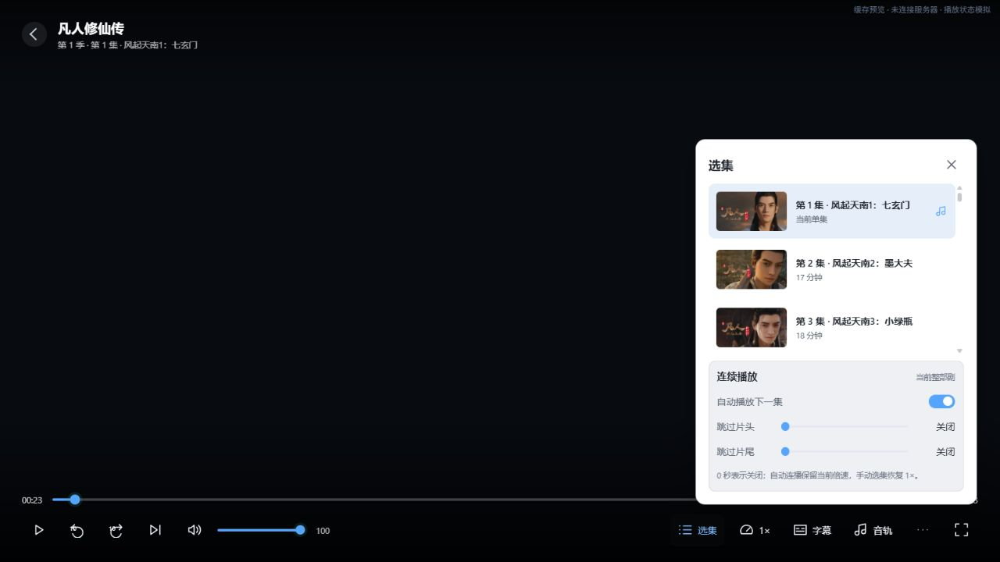

# Windows 正式客户端与最终设计稿核验

2026-10-10。本次直接修正正式 HTML、CSS、JavaScript 和客户端原生接口。修改留在本地，未提交、推送或部署；没有修改服务端。年份筛选按用户最新意见暂不加入。

2026-10-22：本轮界面改动、品牌图标与核验截图已提交并推送至开发分支；图标资源同时用于可执行文件、窗口图标和侧栏品牌。

## 核验基准

以 `design/modern-cinema/index.html` 及其 README 的最终修订为准，包括用户确认的轮播、媒体库、详情、设置、登录和播放状态设计。桌面对照使用相同的 1280×720 视口；另检查 1280×800 和 375×812。

真实数据来自已有 `design/modern-cinema/local-data/catalog.json`。设计稿顶部的缓存告知条占用额外高度，正式客户端不复制该条；比较内容布局时排除这部分。缓存中的 18/18/15 是样本数量，不作为正式全库总数。正式侧栏只展示服务器提供的有效库数量。

## 本轮补齐与修正

| 区域 | 核验发现与最终处理 | 证据 |
| --- | --- | --- |
| 应用外壳 | 对齐侧栏 216px、顶栏 64px、分组间距、品牌字号、线条图标、面包屑和账号入口；顶部搜索改为真实输入框，Enter 复用原生搜索请求 | 首页、媒体库截图；“木乃伊”搜索到缓存中 1 个结果并打开详情 |
| 首页轮播 | 简介限制 80 字且最多两行；图片与文字通过渐变融合，整体横向移动 320ms，移除外框；按实际显示面积、图片比例和 DPR 校验清晰度，侧栏与窗口改变后重新校验或请求更高清图片 | 首页截图；实际点击指示点切换作品，修复控件被 pointer-events 遮挡的问题 |
| 首页卡片行 | 修正旧样式覆盖导致的续播比例错误；桌面续播显示 3 张完整卡片、比例 1.95，海报行显示 6 张；分页按实际容器宽度计算 | 1280×720 下续播图片约 319×164px；分页和键盘操作核验 |
| 媒体库 | 目录只保留 16:9 库封面；库内标题下小字、切库下拉、类型筛选全部移除；保留原题材胶囊、展开、排序、列表/网格及每库状态 | 媒体库目录、动漫库截图；桌面 5 列海报、间距 18px |
| 详情页 | 海报宽 210px，正文收紧并贴近选集；调整背景浓度、字号、简介截断和返回文案；异步加载播放按钮时保持播放在收藏左侧 | 详情截图；播放、收藏顺序和返回动漫核验 |
| 详情选集 | 删除旧横向十集分段布局，改为最终稿的桌面 4 列、窄屏 2 列；保留真实选季、选集请求、续播和后台更新 | 桌面及 375×812 详情截图；窄屏无横向溢出 |
| 设置页 | 改为独立页面，复用同一组正式设置控件；补齐主题预览、选中状态、减少动态效果、字幕样式预览 | 设置截图；设置→媒体库→详情→首页切换核验 |
| 设置生命周期 | 直接进入库内加载页曾卸载设置控件，导致缓存统计回调报错并阻断封面加载；统一内容替换前先停放原设置 DOM，避免重复控件 | 页面来回切换后设置 ID 仍存在、图片正常；加入回归验证 |
| 登录页 | 用最终稿的离线海报素材替换空色块；标题和输入框共用 355px 对齐线；基础字段在前、高级选项在后；卡片随窗口高度调整，统一窄屏断点 | 登录截图；1280×720 卡片完整呈现、无横向溢出 |
| 播放加载 | 展示真实作品名、季集、时长、续播位置与状态；剧集封面取当前作品的真实海报；移除假进度和长简介 | 加载截图；从第 1 集 00:23 继续 |
| 播放控制 | 中央播放/暂停图标仅反馈 750ms，底栏显示下一步动作；播放闲置 3 秒隐藏并禁用焦点，暂停、缓冲、菜单和键盘操作保留控件 | 播放事件回归；截图中暂停后底栏为播放、中央反馈已消失 |
| 播放面板 | 对齐面板尺寸、内边距和主题色；选集显示缩略图、标题、时长及当前集；列表单独滚动，连续播放设置留在列表后；字幕样式控件不再混用旧深色文字 | 选集、字幕截图；外层滚动量为 0，关闭面板焦点回到触发按钮 |
| 播放失败 | 原生失败先完成统一清理，再显示错误页；重试保留来源与位置；返回作品可用，晚到的回调不能恢复旧播放 | 失败截图；失败清理、焦点、重试与迟到回调回归 |
| 收藏 | 接入服务端已有 Emby 收藏接口和分页；写入后再次读取服务器状态，拒绝伪成功；旧缓存未提供收藏状态时先读取状态，不默认当作未收藏 | API 测试覆盖查询、POST/DELETE 后确认及未生效写入；预览明确显示能力不可用 |

## 验证结果

| 检查 | 结果 |
| --- | --- |
| JavaScript 语法 | 通过 |
| 正式 UI 回归脚本 | 通过；播放器事件、设置 DOM 生命周期、图片显示尺寸校验、失败清理三个验证标记均成功 |
| 原 RTX 界面回归 | 通过 |
| MediaStation API 单元测试 | 74 通过，4 项真实服务器集成测试按原规则忽略 |
| 全工作区 Rust 格式 | 通过 |
| MediaStation 生产库严格 Clippy | 通过 |
| 全工作区所有目标严格 Clippy | 未通过；现有 live_server、frame_interpolation 测试使用该命令禁止的 expect/unwrap/panic，且默认 CEF wrapper 构建失败。未修改无关测试或编译链 |
| PowerShell 预览脚本解析 | 通过 |
| Windows release 构建 | 通过；`build/jellium-desktop.exe` |
| 浏览器视觉与交互 | 已核验浅暗主题、轮播点击/横移、真实搜索、库内切换与状态恢复、详情、窄屏、设置、登录、加载、播放面板及错误返回 |

## 验证边界与必要差异

浏览器预览读取真实客户端缓存，右上角始终标识“缓存预览 · 未连接服务器 · 播放状态模拟”。缓存覆盖最近添加和继续观看；库数量、题材、搜索结果仅代表缓存范围。播放事件由开发脚本模拟，浏览器中的黑色背景仅是预览脚本提供的画布；正式播放器仍使用透明 CEF 图层承载原生 MPV 视频。

本次没有验证真实服务器登录、收藏写入、视频画面、GPU、全屏、字幕渲染或 RTX 实机播放，不把预览截图作为这些能力的验收证据。原认证、退出确认、播放进度上报及原生渲染链继续保留。

正式登录保留未登录时的账号选择和连接设置流程，不展示虚假的已登录侧栏。正式播放器保留已有自动连播、跳过片头/片尾、字幕样式、弹幕、RTX 和播放信息设置；设计稿里没有模拟这些原生功能。年份筛选未实现，已有“发行年份”排序仍是原正式排序。

## 页面证据

首页对照：[修正前](images/audit-before-home.png)、[最终设计稿](images/audit-design-home.png)、[正式实现](images/audit-final-home.png)。




其他页面：[深色首页](images/audit-final-home-dark.png)、[媒体库目录](images/audit-final-libraries.png)、[动漫库](images/audit-final-anime.png)、[窄屏详情](images/audit-final-detail-narrow.png)、[设置](images/audit-final-settings.png)、[登录](images/audit-final-login.png)、[播放加载](images/audit-final-player-loading.png)、[字幕面板](images/audit-final-player-subtitles.png)、[播放失败](images/audit-final-player-error.png)。上述图片是最终核验记录，旧的中间测试截图已删除。

## 复现

从仓库根目录运行：

```powershell
. ./dev/windows/env.ps1
cargo test --manifest-path src/Cargo.toml -p jfn-mediastation
cargo fmt --manifest-path src/Cargo.toml --all -- --check
cargo clippy --manifest-path src/Cargo.toml -p jfn-mediastation --lib -- -D warnings -D clippy::unwrap_used -D clippy::expect_used -D clippy::panic
node --check src/web/mediastation.js
node dev/windows/test_modern_cinema_ui.cjs
node dev/windows/test_frame_interpolation_ui.cjs
$clientMpvPrefix = (Resolve-Path -LiteralPath third_party/mpv-install).Path
cargo xtask build --external-mpv=$clientMpvPrefix
```

缓存预览：

```powershell
pwsh -NoProfile -File dev/windows/frontend-preview.ps1 -Port 4176 -CatalogPath design/modern-cinema/local-data/catalog.json
```

打开 `http://127.0.0.1:4176/`；加载失败场景使用 `http://127.0.0.1:4176/?playback=error` 后点击播放。预览仅监听本机，图片文件名限制为散列名，不导入账号、凭据或播放链接。收藏查询/写入在预览中明确报能力不可用，不伪造空收藏或写入成功。未传 CatalogPath 时使用脚本原有开发样例。正式资源没有嵌入缓存数据或播放模拟。

## 登录视觉素材

四张 JPG 复用已确认设计稿的静态素材，并由正式资源处理器以 `image/jpeg` 离线提供。它们只用于登录视觉和字幕样式预览，不作为媒体库内容来源。来源记录见设计稿 `assets/sources.json`：

- [Interstellar 海报](https://en.wikipedia.org/wiki/Interstellar_(film))
- [Dune: Part Two 海报](https://en.wikipedia.org/wiki/Dune:_Part_Two)
- [Blade Runner 2049 海报](https://en.wikipedia.org/wiki/Blade_Runner_2049)
- [Dune: Part Two 背景](https://www.dunepartedos.plataformasdigitaleswb.com/)

## 2026-10-10 截图反馈修正

本轮仅修正正式客户端的七项反馈，没有修改服务端、增加年份筛选、提交、推送或部署。

| 反馈 | 修正与证据 |
| --- | --- |
| 设置选中文字出现局部底色 | 覆盖旧选项卡的 checked 样式；文字背景透明，保留原生单选圆点。浅色与深色计算样式均核验通过。 |
| 继续观看排列松散 | 移除海报卡片的 230px 最大宽度限制，统一内容边距和 18px 列间距；剧名为主标题，集数、单集名、进度放在次行，去掉重复单集名。1280px 三列、800px 两列、375px 一列，均无横向溢出。 |
| 轮播图片阻塞其他封面 | 同一原生图片队列内，前景封面优先；大型背景最多占一个请求槽，总并发仍为原生允许的两个。轮播候选顺序取图，首张清晰图片立即显示，足够四张后停止取候选，替换轮播集合时保留当前作品。 |
| 收藏页未及时刷新 | 每次进入或从详情返回都重新读取首屏；收藏写入确认成功后，刷新已经打开的收藏页。每次刷新有独立请求版本，旧响应和旧失败不会覆盖新列表或清除新请求的 loading 状态。列表仍只使用服务器返回的数据。 |
| 库名后显示 0 | 不再显示零值或未知的 childCount，不制造库总数。 |
| 单集封面黑块 | 移除封面左上角标签，将集数放进卡片标题。实际选集 DOM 的旧标签数量为 0。 |
| 播放 hover 白底白字 | 将基础主按钮 hover 改为强调色混入 14% 黑色，并显式保留白色文字；禁用按钮不触发该 hover。浏览器加载后的样式规则已核验。 |

收藏诊断修正：切换账号后能够读取收藏，支持继续核验刷新时序。此前本地服务端源码中发现的聚合 ID 问题不足以证明当前运行实例的根因。本轮只读请求真实服务器时遇到连接失败（URLError），未完成真实账号收藏回归；没有用本地列表插入、忽略接口错误或伪造成功来掩盖这个验证边界。

回归验证：`node --check`、现代 UI 五组回归、RTX UI 回归、`git diff --check` 全部通过。新增回归故意挂起轮播图片，验证普通封面可以先完成；收藏回归覆盖详情返回、收藏写入与页面切换重叠、旧响应晚到和旧失败晚到。

Windows release 已完成正常输出替换：`build/jellium-desktop.exe`，5,765,120 字节，2026-10-10 14:44:48。输出与 `build/cargo-target/release/jellium-desktop.exe` 的 SHA-256 一致：`B7A1B2A5B835FD3716C6346AD60E6C4169FAEA8FC68697113480EB8EDBD1EE4C`。第一次复制被正在运行的客户端锁定，用户正常退出后重新构建成功，没有强制终止进程。

截图来自真实客户端缓存的开发预览，延续上文的模拟边界：[继续观看](images/audit-fix-resume.png)、[系统代理设置](images/audit-fix-settings.png)、[单集标题](images/audit-fix-episodes.png)。
