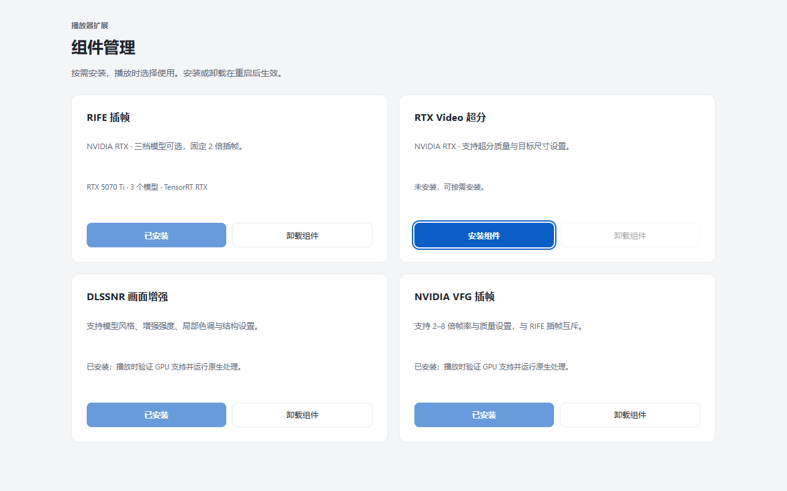
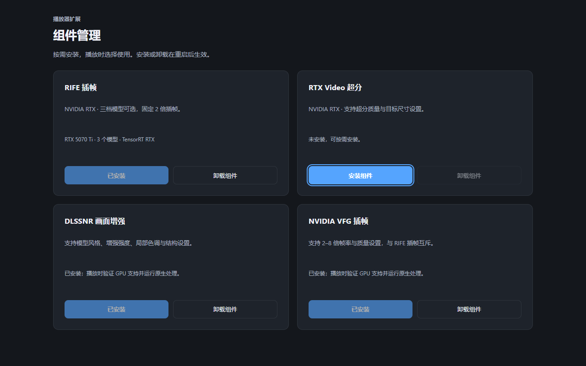
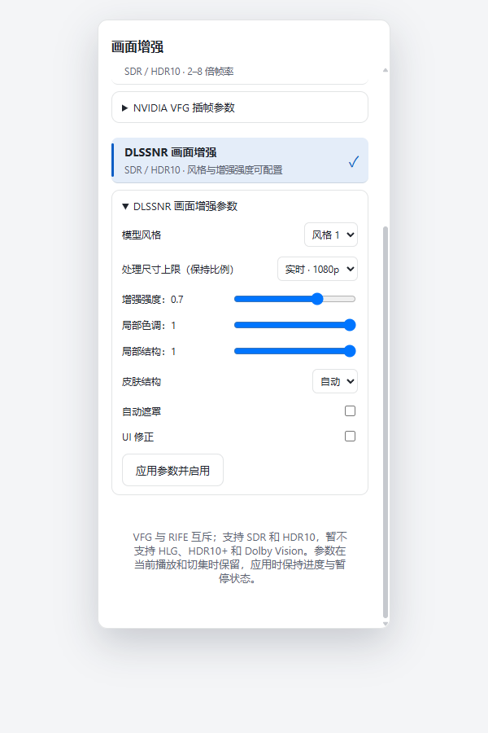
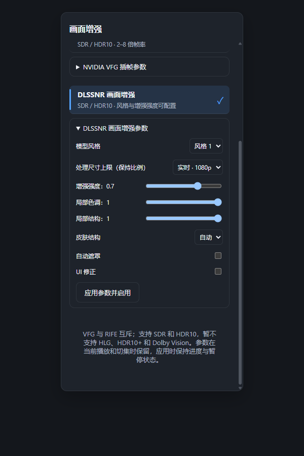

# Windows 视频组件管理与接入

2026-10-22 后续整合：用户已授权首页修复与以下 VFG/播放面板改动一起交付本机。
首页修复、最终 EXE/视频桥校验及回滚位置见 [首页启动修复](windows-home-startup.md)。
下面的已安装/未安装、回滚描述均为各阶段记录，当前交付以该文档及安装审计为准。

## 2026-10-22 VFG 交互延迟与同步修复

用户补充问题集中在操作栏二级面板及后续操作、弹幕卡顿，并确认修复。当前安装桥
已经因黑屏回滚至 `11050f90...`；下方 `53d16027...` 安装记录仅代表此前阶段，
不是本次修复后的已安装状态。本次保留 RIFE、档位、自动目标规划、音频速率和刷新率。

实现：

- 面板先呈现明确的读取状态，再等待音轨、组件或播放诊断。关闭/切换面板会使旧请求
  失效；同类面板重开也不会被旧响应覆盖。失败显示原错误，不使用缓存伪装查询成功。
- 播放诊断中的同步 mpv 属性查询在独立工作线程执行，通过既有响应派发返回 CEF；
  线程启动失败显式报错。音轨和增强应用继续复用原有处理链。
- VFG 为 SDR 输入创建会话自有 D3D11 纹理，HDR 复用自身转换纹理；三份纹理只在
  创建/销毁会话时注册/注销 CUDA。每个新帧对上传后重绑两路 SDK 输入并重置
  `ShotChange=0`，同帧对后续样本不重复上传。纯 CUDA 推理不持有 D3D11 上下文锁；
  输入/输出拷贝、map/unmap 和完成同步仍在隔离上下文内。其他 provider 保持完整隔离。
- 同步更新 `resources/win/video-bridge/video_enhancement.dll`：标准打包最后会用
  此预编译桥覆盖 mpv 目录中的桥，仅修改 C++ 或中间 DLL 不会进入最终产品。ABI 仍为 5。

失败候选：最初把 CUDA map/unmap 也放到上下文锁外，640×360 GPU 对照通过，但
4K mpv 多线程播放出现 CUDA map `0x3e7` 和 `DXGI_ERROR_DEVICE_HUNG`。该候选废弃，
未更新用户安装目录。恢复 map/unmap 隔离后，再仅释放纯 CUDA 推理阶段的锁。
日志为 `build/vfg-latency-4k25/`，稳定中间检查为 `build/vfg-latency-locked-4k25/`。

最终验证（RTX 5070 Ti / 596.49 / 152 Hz，VFG Medium）：

| 场景 | 结果 |
| --- | --- |
| 4K25 → 50.666667 fps，预热 5 秒 + 60 秒 | SDK 均值/最大 6.813/23.098 ms；内部音画偏差 P99/最大 13.994/14.039 ms |
| 4K25 → 76 fps，预热 5 秒 + 60 秒 | SDK 均值/最大 6.557/14.246 ms；内部音画偏差 P99/最大 14.817/14.845 ms |
| 上述两组播放控制 | 播放/解码丢帧、mistimed/delayed 为零；音视频速度修正均为 1；暂停/跳转及字幕验证通过 |
| SDR/PQ/HLG 自动输出 | 源/输出结束均为 4 秒，seek/EOF 通过；SDR 音轨切换、暂停跳转、内嵌/外挂字幕通过 |
| 连续帧对 GPU 对照 | Low/Medium/High，固定倍率/任意 timestep，72 个输出与每对新会话参考逐分量误差 ≤1；HDR 三 provider 检查通过 |
| CEF + 4K25 VFG，窗口/全屏各 65 秒 | 排除前 5 秒后，弹幕源回调 151.791/152.021 FPS，间隔 P99 8.5/8.2 ms；24 次信息面板打开及倍速选项操作通过 |
| 面板时延 | 信息面板同步建立读取状态，下一次 rAF 最慢 40.6/5.9 ms；诊断查询连同后续选项操作最慢 68.7/70.0 ms；倍速选项操作 0.4–1.4 ms |

联合测试使用正式 CEF 内的面板处理函数、原生诊断 IPC 和当前弹幕渲染器，播放本地
合成片及 WASAPI 静音音轨；通过调试器导出局部处理函数并设置测试 player，不使用
真实账号播放加载。只对比本任务相关的嵌入 JS 函数，工作区并行存在其他首页修改。
播放端累计掉帧为 8/4（包含初始化，未采样起始计数），不能称为稳定阶段零掉帧。
桌面 DXGI 采样未能读到有效弹幕标记，**上屏验证未通过**；后续 CEF-only 采样明确
记录 `presentationCapture=false`，不把 rAF、内部时钟或界面 DOM 状态当作实际显示延迟。
原片随机回退仍未复现，重绑符合 SDK 合同，但尚不能认定是回退的唯一根因。

新增 `dev/windows/test_player_panel_async.cjs` 覆盖延迟回复、关闭、切换、同类重开、
查询失败及组件失败；组件/插帧/弹幕 JS 回归、真实浏览器参数面板检查及 110 项 CEF
Rust 单测通过（4 项依赖外部环境的测试忽略）。严格 Clippy 被 HEAD 已有的
`collapsible_if` 一处和 `redundant_closure` 两处阻挡，未修改无关实现。
仅放行这两类既有 lint 的 scoped Clippy 通过。最终随包 DLL 单独重新执行 SDR 连续帧对
及 PQ/HLG 三 provider GPU 检查通过，记录在 `vfg-latency-packaged-gpu.log`。

复现命令及证据：

```powershell
node dev/windows/test_player_panel_async.cjs
./dev/windows/build_video_enhancement.ps1 -TestGpu
./dev/windows/test_video_enhancement.ps1 -AutoOnly
./dev/windows/test_vfg_cadence.ps1 -SourceSize 3840x2160 -SourceRate 25 -Quality 1 -VideoSync display-vdrop -Seconds 60 -ExerciseControls -ResultDirectory build/vfg-latency-final-4k25
./dev/windows/build.ps1
```

`build/video-enhancement/vfg-latency-{final-gpu,native-auto,rust-tests,clippy}.log`、
`build/vfg-latency-final-4k25/{manifest.json,divisor-*-summary.json}` 和
`build/vfg-ui-latency/cef-only-{summary.json,*-manifest.json,*-source.json}` 保存原始结果。
联合测试的 `run.cjs`、`prepare.cjs` 和 `summarize.cjs` 保留复核方法；测试进程、媒体和
临时 config/cache/engine 已清理。最终标准构建及随包桥 hash 见
`build/video-enhancement/vfg-latency-final-audit.json`。未替换用户安装目录、提交、推送或发布。

## 2026-10-22 VFG 帧对切换检查与本机修正

用户报告开启 VFG 后画面随机抽搐回退，暂时无法定位片段。只排查并修正 VFG
帧对通知，未改 RIFE、音频速率、刷新率、用户档位或自动帧率策略。

- 实际安装目录为 `D:\softwares\MediaStationGo`。原视频桥与本地构建 SHA-256
  均为 `11050f90014de9ba477d2c9678f7b1de5138465dbe4a90501dabdc3e822330d7`。
  用户保存的选择为 VFG Medium、自动倍率、切镜检测开启，VSR/NR 关闭。
  本机日志 21:07–21:21 显示 4K / 25 fps 在 152 Hz 下自动规划 50.666667 fps；
  21:08:05 和 21:08:26 有音画不同步警告，不能据此判断画面内容是否倒退。
- `video_enhancement.cpp` 原来只在初始化时绑定 `SrcImage0/1`。现在每次
  `index == 1` 上传新输入后重新绑定两个图像，同一帧对后续样本保持绑定。
  [NVIDIA 官方示例固定版本的 628–632 行](https://github.com/NVIDIA-Maxine/VFX-SDK-Samples/blob/52011f89c1741d06b40ea312af1f20be8be9ec62/apps/VideoFrameGenerationEffectApp/VideoFrameGenerationEffectApp.cpp#L628-L632)
  明确要求即使缓冲地址不变也必须在每个新帧对重绑。新增调用沿用现有显式错误处理，
  不回退、不改原生 ABI 或组件包。
- GPU 新增固定 4 倍/任意 timestep、Low/Medium/High、四个变速/反向帧对的
  72 个逐输出对照。参考会话全部结束后才运行连续会话，复用同一组输入分配；
  与每对新建会话的基线逐分量最大差不超过 1。**旧桥也通过该合成对照**，
  所以这只能验证更改后的连续帧对处理，不能当作已复现并修复随机回退的证据。
- `build_video_enhancement.ps1 -TestGpu` 的时钟、三类 provider、PQ/HLG 数值检查
  通过；`test_video_enhancement.ps1 -AutoOnly` 的 SDR/PQ/HLG 原生 seek/EOF 和
  时间轴通过，SDR 的切音轨、内嵌/外挂字幕、暂停跳转通过。最大音画偏差分别约
  0.2 / 0.0 / 0.0 ms，均为短合成源的内部时钟检查。
- 基准脚本新增可选 `-SourceRate 25`，默认仍为 `24000/1001`。RTX 5070 Ti /
  596.49 / 152 Hz，3840×2160 / 25 fps / Medium / display-vdrop，预热 5 秒、
  各采样 15 秒、WASAPI 静音时钟，50.666667 / 76 fps 的 SDK 平均耗时为
  6.997 / 5.974 ms，最大 13.468 / 14.309 ms；播放端掉帧为 1 / 0，解码掉帧
  均为零，延迟帧为 1 / 0，音画偏差 P99 为 19.887 / 2.753 ms，音视频速率修正
  均为零。前者仍有调度异常；短测不能证明 76 fps 始终更稳，也不是物理上屏测量。

复现命令：

```powershell
./dev/windows/build_video_enhancement.ps1 -TestGpu
./dev/windows/test_video_enhancement.ps1 -AutoOnly
./dev/windows/test_vfg_cadence.ps1 -SourceSize 3840x2160 -SourceRate 25 -Quality 1 -VideoSync display-vdrop -Seconds 15 -ResultDirectory build/vfg-pair-4k25-medium
```

证据为 `build/video-enhancement/vfg-pairs-{before,after}.log`、
`vfg-pair-playback.log`、`vfg-pair-install-audit.json` 和
`build/vfg-pair-4k25-medium/{manifest.json,divisor-*-summary.json}`。
测试媒体、测试进程和临时缓存已清理，保留测量日志与回滚产物。

确认播放器全部退出后，将新桥复制到标准 `build/video_enhancement.dll`、
`third_party/mpv-install/lib/video_enhancement.dll` 和安装目录，逐一校验 SHA-256 为
`53d1602726d3bf4a1dd6549e441c4b146229e3167d51ea8e9d5a5c8bb510c5a7`。
旧桥保存在 `build/video-enhancement/vfg-pair-rollback/video_enhancement.dll`。
未重新编译 EXE、启动用户播放器、提交、推送或发布；下次启动加载新桥，实际随机
回退是否消失仍待观察。若继续出现，应采集同一片段的输入/生成帧及呈现 PTS，
区分 SDK 生成伪影、切镜行为与呈现调度，不静默降档或改变目标帧率。

2026-10-11，分支 `codex/mediastation-windows-spike`，本地实现与验证记录。

侧栏新增“组件管理”，原设置中的 RIFE 安装、卸载、待安装取消与重启确认均迁入。
四项组件共用同一个按用户安装的事务实现，各自有独立目录、下载状态和缓存。
RTX Video、NVIDIA VFG 与 DLSSNR 均已接入 mpv 原生播放，核心参数可配置。
安装不会自动开启增强，安装和卸载在退出全部实例并重启后生效。

| 组件 | 安装管理 | 播放能力 | 当前边界 |
| --- | --- | --- | --- |
| RIFE | 沿用既有组件，增加本地导入入口 | 原有三档与固定 2 倍插帧 | ABI 8、模型、TensorRT profile 与 HDR 路径保持原合同 |
| RTX Video | 原版 `nvngx_vsr.dll` 1.6.0.0 | D3D11 RTX Video SDK，质量 1–4 与 2x/QHD/4K–8K 目标尺寸 | 渐进 SDR / HDR10 / HLG；HDR 使用代理推理和原图残差合成 |
| NVIDIA VFG | Maxine VFX 1.3.0 五个原始 DLL | Low/Medium/High，自动匹配刷新率或手动 2–8 倍，可配置自动切镜检测 | 渐进 SDR / HDR10 / HLG；HDR 使用 RGB10A2/PQ；与 RIFE 互斥 |
| DLSSNR | NVIDIA 原版 310.8.0.0，可安装、取消、卸载 | D3D12 Feature 18 实际推理，模型参数与处理尺寸可配置 | 渐进 SDR / HDR10 / HLG；HDR 使用代理推理和原图残差合成 |

## 使用

1. 打开侧栏“组件管理”，点击“安装组件”，在弹窗选择“从本地安装”并选择对应组件 ZIP。
2. 校验并排队完成后，原按钮变为“重启生效”，点击后确认重启；也可稍后重启或点击“取消安装”。
3. 播放渐进 SDR、HDR10 或 HLG 视频，在播放器“画面增强”菜单选择插帧引擎、超分或画面增强，配置后统一点击“应用设置”。
   NR、VFG 与超分可叠加；开启 RIFE 会关闭 VFG。关闭插帧保留 NR 与超分选择。

本次三个新组件包仅生成于 `dist/components`，尚未发布 GitHub Release。
“下载并安装”仍使用既有受校验的 Release 下载链路，未发布时明确提示使用本地包，
不会改从第三方镜像寻找同名 DLL。组件包文件名如下：

| 组件包 | SHA-256 |
| --- | --- |
| `MediaStationGo-rtx-video-x64-v1.zip` | `6f8c7ca16634437f83f8890433060a93daaca29cdb6bbb361829002d4c431e25` |
| `MediaStationGo-dlssnr-x64-v1.zip` | `c7daf9e2a8287b228c11055fdc1f598e92697948eef44c7729d113ba8f5ed686` |
| `MediaStationGo-nvidia-vfg-x64-v1.zip` | `13c2e0493b1aaa6bb8d3b93f9b6a70d60359db78c672d6963dfcea50987f1cdb` |

## 组件操作与播放设置交互修复

2026-10-11，本轮只修改界面与调用组织，复用既有组件安装事务和播放重载。

- 四项组件始终保留两颗操作按钮。已安装状态显示“已安装”并使用正常指针；只有正在处理或重启时显示进度指针。安装来源、卸载、重启确认共用弹窗，不再往卡片底部展开操作区。
- 安装完成后在原位置提供“重启生效 / 取消安装”，不会自动弹出重启确认；损坏的待安装包明确禁止重启，仍可取消。卸载沿用下次启动生效的原合同。
- 播放设置按插帧、RTX Video 超分、DLSSNR 画面增强分组。先选关闭 / RIFE / VFG，再配置对应引擎；RIFE 三档属于 RIFE 内部参数。所有参数与开关先保留为面板草稿，统一应用时只调用一次既有重载；关闭面板丢弃未应用修改。
- 应用时保留播放位置、媒体版本和暂停状态。不可用的组件可以关闭，但不能重新启用；错误保持明确可见。
- 重载提示按实际差异显示开启、关闭、切换或参数应用。只改超分显示“正在开启超分 / 正在关闭超分 / 正在应用超分参数”，只改 NR 显示对应画面增强提示，多项变化显示“正在应用画面设置”。提示持续到重载完成，不会因原生参数回执更新而变成插帧关闭。

验证使用真实 JS 处理函数、故障注入与浏览器离线状态：
`test_frame_interpolation_ui.cjs`、`test_video_components_ui.cjs`、
`test_video_components_detection.cjs` 与 `test_modern_cinema_ui.cjs`。
浏览器验证由 `render_video_parameters_ui.cjs` 生成真实 HTML/CSS/渲染函数测试页面，
`test_video_settings_browser.cjs` 检查浅色/深色、1280×800 与 480×800、模态确认不挤压卡片、
Escape 焦点恢复、固定操作数、草稿编辑不重载、RIFE 三档嵌套及统一应用。
浏览器脚本需要可用的 `playwright` 和 Chrome，Chrome 路径可通过 `VIDEO_UI_CHROME` 指定。

标准 Release 构建通过。真实用户目录首次首页检查再次确认 DLSSNR/VFG 已安装且原生可用，
RTX Video 未安装；随后在实际 CEF 页面检查“已安装”指针、安装来源弹窗及卸载弹窗，均取消，
未执行组件变更或启动用户媒体。记录为
`build/video-enhancement/component-settings-app.json` 与
`build/video-parameters-ui/browser-validation.json`；可复现真实页面检查
`node dev/windows/test_video_settings_app.cjs <调试端口>`。
标准应用 SHA-256：`cf21fbeed23c4d0ed238da6cfa77be98797451cebae30c7cb0956cf31d00ebf7`，
启动状态汇总见 `build/video-enhancement/component-settings-release-validation.json`。
本轮未重复 GPU 算法/画质验收，未改组件 ZIP、HDR 格式边界、RIFE 模型/profile/ABI 或刷新路径。
仅本地更新与提交，未推送或发布。

## 2026-10-20 VFG 按显示刷新率自动规划（本地实现与验证）

- VFG 输出帧率增加“自动”，保留手动 2–8 倍；新选择默认自动，安装组件仍不会自动开启增强。
- 自动规划只使用原生滤镜收到的源 `nominal_fps` 和 mpv 当前 VO 的实际显示刷新率。
  选择 `display_hz / divisor` 中高于源帧率、最接近源两倍的帧率；距离相同时取较低者。
  24 / 23.976 fps 配 152 Hz 得到 50.666667 fps；24 fps 配 144 Hz 得到 48 fps。
  这是显示节奏规划，并非 GPU 算力自适应；任意采样可能比固定两倍调用更多次 SDK。
- SDK 使用 `FrameMultiplier=0` 和每次输出独立的 `Timestep`，不是把整数倍率四舍五入。
  视频按目标时间网格重采样；只有时间戳与网格重合的原帧直接输出，其他网格点由相邻源帧插值。
  每次下游请求只生成一帧，复用结果纹理，不再提前阻塞生成整组中间帧。
  原帧与生成帧统一进入同一输出 `AVHWFramesContext`；原帧只在 GPU 内复制可见区域，
  避免解码/转换帧池与生成帧池交替触发下游 `d3d11vpp` 和 VO 反复重建。
- 视频保持源 PTS 时间轴和原播放速度，音轨与软字幕继续由 mpv 处理，软字幕在视频滤镜之后渲染。
  EOF 将最后一个源画面保持到源帧结束时间，再输出 EOF；末帧时长截到准确源结束位置。
  跳转清空采样历史；跨屏或刷新率变化在下一源帧边界重新规划，保留播放时间轴。
  烧录字幕属于视频像素，仍会参与插值；本轮没有独立识别或重绘硬字幕。
- 缺少有效源帧率、显示刷新率，或显示刷新率不高于源帧率时明确失败，不静默改为固定倍率或关闭。
  UI 的播放信息显示原片/输出帧率、显示分频及 SDK 平均/最大处理耗时。
- 自写桥升级为 ABI 5，增加显式 timestep 入口；NVIDIA 组件 ZIP、RIFE ABI 8、模型和 profile 不变。
- 已通过 CPU 分频规划/10 小时时钟、SDR/PQ/HLG 任意 timestep GPU 探针、
  137 项 Rust 测试（5 项依赖真实环境的既有测试保持忽略），以及前端参数/草稿/重载回归。
  `build/vfg-playback-validation.log` 记录 22 条原生播放组合全部通过，包含自动档 SDR/HDR10/HLG、
  手动倍率与既有 NR/VSR 组合；High 8x 仍记录算力不足导致的音画落后，不将其记为实时性能通过。
  `build/vfg-1080p-validation.log` / `build/vfg-4k-validation.log` 记录额外的 SDR Low 自动档通过。
  三种 SDR 尺寸均通过音轨切换、暂停跳转、内嵌/外挂软字幕、均匀输出和 EOF 源/输出结束时间一致检查。
  640×360 / 1080p / 4K 的 SDK 平均处理耗时为 2.604 / 2.957 / 4.117 ms，
  最大音画时钟偏差为 3.7 / 0.3 / 0.3 ms；包含切轨/跳转的各段实际 VO 重配置均为 3 次，
  PQ/HLG 小尺寸自动段各为 1 次，不再随原帧与生成帧交替反复重建。
  可复现命令为 `dev/windows/test_video_enhancement.ps1`；
  `-AutoOnly -VfgSourceSize 1920x1080` / `3840x2160` 分别验证 SDR 1080p / 4K 自动档。
  同步样例为 4 秒、24 fps、AAC 48 kHz、双音轨、内嵌 mov_text / 外挂 SRT，音频使用 mpv `ao=null` 时钟。
  它不代表 TrueHD/DTS 直通、真实声卡延迟、HDR 4K 或长片热稳定性验收。
  音轨切换推进视频后再单独执行暂停精确跳转；连续同时提交切轨和跳转时，曾观察到 mpv 解码器等待关键帧，
  本轮没有修改该 demux/decoder 边界，也不将这组并发操作记为通过。
- 用户授权退出并重开后，标准 `dev/windows/build.ps1` 构建通过（`build/vfg-app-build.log`），
  `build/jellium-desktop.exe`、`libmpv-2.dll` 与 ABI 5 视频桥已替换，逐文件 SHA-256 与构建源产物一致。
  2026-10-20 23:43:13 启动的新主进程 PID 3512，主窗口 `MediaStationGo` 存在且响应正常；
  23:43:14–15 启动日志确认 mpv/CEF 初始化、152 Hz、首页 HTTP 200 与主事件循环，
  进程实际加载的 `libmpv-2.dll`、`libcef.dll` 均来自本工作区 `build` 目录。
  此次启动未自动播放用户媒体，不替代上述播放验证或长片验收。
  旧实例发送正常关闭请求后超时，仅终止核验归属的 PID 7684 及其 CEF 子进程；退出生命周期未修改。
  已替换 EXE SHA-256：`946b73cd6f5824b040dc05aebf8d5eb22e44e57445bfc995c7b62d138ab5eb4d`；
  `libmpv-2.dll`：`d87881c4b91972c1fca5a6e3b317b2a0d6d71dc650a47c83152f29eedaf789a2`；
  本次标准流程重编视频桥：`ea105504c212f51719ab7a3a2274fcaa7889165c9a899233595ee3a1c04daf92`。
  测试媒体/引擎临时目录已清理；短路径测试盘符映射已撤销。
  自动审批以策略拦截拒绝递归删除 `build/vfg-rust-test` 编译缓存，该生成缓存保留在工作区内。
  本轮仅本地修改与验证，未提交、推送或发布；尚不声明长片实播验收。

## 2026-10-21 VFG 50.667 / 76 fps 对比验证

用户同意同场景比较；本轮保留应用的自动默认策略与标准 `build` 播放器产物，
没有把 76 fps 直接改成默认。原生滤镜增加显式 `display-divisor`（要求 VFG、`multiplier=0`），
3 / 2 分别选择显示刷新率的三分之一 / 二分之一；非法目标与整数倍率冲突明确拒绝。
显式与自动选择共用 `vfg_plan_divisor` 校验和既有目标时间网格，不增加另一条插帧实现。

`dev/windows/test_vfg_cadence.ps1` 生成同一 23.976 fps 横移网格画面、双 AAC 音轨与内嵌软字幕，
两档复用同一个源文件；每档 5 秒预热后测量 60 秒。使用 RTX 5070 Ti / 596.49、152 Hz、
VFG Low、`gpu-next` / D3D11、`video-sync=audio`，WASAPI 真实声卡时钟、播放器音量为零。
可见原生测试窗口外框 1920×1080，4K 指源与 VFG 处理分辨率，未覆盖 CEF 合成、全屏 4K 输出或 HDR。

| 源分辨率 | 目标 fps | SDK 平均 / 最大 ms | 最大音画时钟偏差 ms | mpv 掉帧 / 延迟帧 |
| --- | --- | --- | --- | --- |
| 1920×1080 | 50.666667 | 2.996 / 7.048 | 0.1731 | 0 / 0 |
| 1920×1080 | 76 | 2.562 / 7.678 | 0.1984 | 0 / 0 |
| 3840×2160 | 50.666667 | 4.190 / 10.787 | 0.1860 | 0 / 0 |
| 3840×2160 | 76 | 3.605 / 10.819 | 0.2190 | 0 / 0 |

原始日志为 `build/vfg-cadence-1080p.log`、`build/vfg-cadence-4k.log`；逐次摘要与采样 CSV 在
`build/vfg-cadence-1920x1080-20261021-144242`、`build/vfg-cadence-3840x2160-20261021-144607`。
证据仅支持该合成场景 Low 档的播放端可行性，不代表长片、复杂运动画质、Medium/High 或直通验收。
`mistimed-frame-count` 在音频同步模式不可用，摘要明确写 `null`，不当成零。

实际呈现采集最初使用 Intel 官方签名的 PresentMon 2.6.0；普通权限启动 ETW 返回 `access denied`。
用户授权 UAC 后，日志确认 `elevated=true`、开始/停止录制与退出码零，但没有生成显示 CSV；
2.3.1 同样如此。进程名缩短、取消进程过滤、禁用 GPU 耗时跟踪均未恢复显示记录。
显式同时关闭显示/GPU 跟踪后，两版都能采到 DXGI 提交事件，故没有将空显示结果或退出码零当成通过，
也没有把权限问题继续当作本轮失败原因。未更改 Windows 设置或用户组。
授权后的 60 秒重测和失败日志见 `build/vfg-cadence-1920x1080-20261021-145342`；
带有效参数、管理员状态与控制台输出的短测见 `...-150252`、`...-150438`、`...-150827`、`...-151157`，
独立采集探针在 `build/vfg-capture-probes`。

提交节奏另外比较了 `audio` / `display-vdrop`，每档均完成 60 秒播放。
固定采集定时器早于最后一档播放结束，提交分析明确统一取每档预热后的前 30 秒，
没有把最后一档的不完整 60 秒当成完整采集。50.667 / 76 fps 在 `audio` 下的提交间隔均值为
19.7359 / 13.1576 ms，p99 为 21.5103 / 14.7216 ms；
`display-vdrop` 则每个显示刷新提交一次，重复视频帧也会提交，不能据此认定不同视频帧均匀显示。
四组播放端掉帧均为零，显示同步组最大内部音画时钟偏差 10.6015 / 17.3539 ms。
原始 CSV、分析脚本与 `submission-comparison.json` 在 `build/vfg-submission-20261021-151353`，
输出显式标注 submission-only，未赋予实际显示时间或物理掉帧含义。

为取得显示证据，临时诊断版 mpv 在独立线程约每毫秒查询 `IDXGISwapChain::GetFrameStatistics`，
仅记录 `PresentCount` 变化。分析使用 Windows 已显示帧对应的 `PresentRefreshCount`；
要求它与 `SyncRefreshCount` 相同，才将 `SyncQPCTime` 当作该刷新时间，完全不使用查询线程时间估算上屏时间。
帧计数跨越大于一的区间标记为未观测，不均分成理想间隔、不当成物理掉帧；已知间隔覆盖率低于 99% 明确失败。
这次单个活动物理显示器、152 Hz、1080p 源与原生窗口、Low、`video-sync=audio`，
5 秒预热后两档各 60 秒结果如下：

| 目标 fps | Windows 显示 fps | 已知间隔覆盖率 | 显示间隔 p95 / p99 / 最大 ms | 已观测刷新周期及数量 |
| --- | --- | --- | --- | --- |
| 50.666667 | 50.6713 | 99.4733% | 19.7378 / 26.3164 / 26.3173 | 2:113、3:2796、4:113 |
| 76 | 75.9986 | 99.9122% | 13.1583 / 13.1586 / 19.7377 | 1:35、2:4484、3:35 |

两档的真实刷新节奏都存在长短间隔混排，已观测间隔偏离理想周期的比例约 7.48% / 1.54%。
两档最大 SDK 耗时 10.887 / 9.041 ms、播放端掉帧零，内部音画时钟偏差最大 0.1393 / 0.1761 ms；
这些内部音画数值不代表屏幕与扬声器实际延迟。
另一次 5 秒短测中，50.667 fps 全部保持三周期，而 76 fps 有 52/275/52 个一/二/三周期，
与长测比例不同。因此只支持“目标分频匹配仍不能保证输出相位对齐”；
初始相位是后续排查方向，尚未证明具体调度修复，也不能宣称 76 fps 始终更稳或达到电视/投影的画质。

证据为 `build/vfg-dxgi-probe/audio-60/{manifest.json,divisor-*-summary.json,divisor-*.log,dxgi-comparison.json}`；
短测在 `thread-smoke`。同目录保存诊断源码、构建/测试日志及 `analyze-dxgi.ps1`。
诊断 DLL SHA-256 为 `948ecf032309da25e2bf186a112f6e40be844b5fefcc211c7af6f3f7a3b2b7d0`；
测试后候选 DLL 恢复为 `042c21f14efc9df594948e0a4ccd908cc586935ef3e77665ac4cf7fa943c93c2`，
mpv 子模块恢复干净，标准 `build/libmpv-2.dll` 仍为上文 10-20 的 `d87881c...`。
这属于 Windows 显示统计，不是光学面板响应测量；物理掉帧字段保留 `null`，没有覆盖 4K 显示节奏、CEF 合成或复杂影片画质。
接口边界见 [微软 DXGI_FRAME_STATISTICS](https://learn.microsoft.com/en-us/windows/win32/api/dxgi/ns-dxgi-dxgi_frame_statistics)
及 [GetFrameStatistics](https://learn.microsoft.com/en-us/windows/win32/api/dxgi/nf-dxgi-idxgiswapchain-getframestatistics)。

测试脚本支持显式 `-PresentMonPath ... -ElevatePresentationCapture`，仅提升采集助手，
保留有效参数、控制台日志和退出状态；定时器覆盖两档硬截止时间，异常退出也等采集器结束后清理。
`dev/windows/analyze_vfg_cadence.ps1` 按进程 ID 与预热后的 QPC 边界分析实际显示 CSV，
缺少采样、多个交换链或字段不符均明确失败；本机仍未取得 PresentMon 显示 CSV，不能宣称该分析器已完成实测验收。
字段含义见 [PresentMon 官方文档](https://github.com/GameTechDev/PresentMon/blob/v2.6.0/README-ConsoleApplication.md)。

可复现播放命令为 `dev/windows/test_vfg_cadence.ps1 -Seconds 60`，4K 加 `-SourceSize 3840x2160`。
CPU 分频边界、默认策略与 10 小时时钟测试、候选 mpv 重编、原生测试 `/W4 /WX` 编译均通过。
本轮临时媒体、引擎缓存和原生测试程序已由脚本清理，保留 CSV/日志作为测量证据。
自动审批以策略拦截拒绝清理三处早期试跑目录，暂留在 `build/vfg-cadence-1920x1080-20261021-143945`、
`...-144039`、`...-144120`。
收尾时清理 `build/vfg-dxgi-probe` 的 `original-libmpv-2.dll` / `instrumented-libmpv-2.dll` 副本，
及 `build/vfg-capture-probes/{capture.ps1,capture-cpu.ps1}`、
`build/vfg-submission-20261021-151353/capture.ps1` 也被自动审批以 `blocked by policy` 拒绝。
这些文件保留，没有重试其他删除方式。正常基准的临时源/媒体/缓存已自动清理；本轮未提交、推送或发布。

### 2026-10-21 晚间 VFG 显示同步修复

本轮只为启用 VFG 的 MediaStationGo 文件设置 per-file `video-sync=display-vdrop`。
该模式按显示 vblank 调度视频，通过必要的重复/丢弃视频补偿时钟差，保持 mpv 的
`speed_factor_a=1.0`、`speed_factor_v=1.0`，不使用会改变音频速率的 display-resample。
loadfile 的文件级选项由 mpv 在后续加载时恢复，普通播放与 RIFE 不传入 VFG 同步覆盖。
自动目标仍按原策略从显示分频中选择接近源两倍的目标，不凭平均提交率将 76 fps 改成默认。

mpv 在窗口不可见、暂停或刷新信息不可用等条件下可能不启用显示同步；播放信息明确显示
实际 `display-sync-active`，诊断还包含配置模式和音视频速度修正，不能把配置值当成运行状态。
原生基准对整个测量阶段检查同步活跃及音视频速度修正均为 1.0，使用 WASAPI 静音真实声卡时钟。

测量脚本 `dev/windows/test_vfg_display.ps1` 临时构建诊断 DLL，采样后恢复 mpv 两个源文件与候选 DLL。
独立高精度计时线程及 Present 后查询共同记录 DXGI 统计；gpu-next 将实际单幅 libplacebo 源图像 PTS
关联到 `GetLastPresentCount`。分析只接受有匹配实际刷新 QPC 的显示事件，按源图像 PTS 合并重复呈现，
不把每次 vblank 的同图重提当成新视频帧。直接读取 mpv 日志文件，不依赖有界客户端日志事件队列。
计数跳跃时，只有所有中间提交均证明为旧 PTS，才确认新内容起点；其他起点及受影响间隔保持未知。
覆盖率分母包含可能漏见的内容转换，`physicalDroppedFrames=null`，不估算丢失边界或均分理想时间。

`analyze_vfg_display.ps1` 默认要求至少 99% 完整内容间隔覆盖，失败仍保存报告并抛错。
显式 `-ReportOnly` 只用于保留部分采样证据，会输出门禁失败警告并在 JSON 中保留
`meets99PercentCoverageGate=false`；此时分位数仅描述完整观测间隔，不证明未观测部分无卡顿。
完整保留八组数据而明确报告覆盖门禁失败时，可运行
`dev/windows/test_vfg_display.ps1 -Seconds 60 -ReportPartialSampling`；不带此开关则首次覆盖不足即失败。
分析回归覆盖相同图像重复提交、已证明的重复帧采集缺口、未知内容起点拒绝及物理丢帧未知值。

最终对比使用相同 RTX 5070 Ti / 596.49、152 Hz、Low 档、23.976 fps 横移源与 WASAPI；
每种分辨率/同步模式的两个目标各预热 5 秒、测量 60 秒。下表仅统计完整观测的内容间隔，
新模式四组均未达到 99% 完整覆盖门禁，因此不是全量上屏节奏验收通过：

| 源分辨率 | 同步模式 | 目标 fps | 完整内容间隔覆盖 | 条件 p99 / 最大 ms | 已观测刷新周期及数量 |
| --- | --- | --- | --- | --- | --- |
| 1080p | audio | 50.666667 | 100.0000% | 19.7432 / 19.7499 | 3:3037 |
| 1080p | audio | 76 | 100.0000% | 19.7373 / 19.7467 | 1:366、2:3827、3:365 |
| 1080p | display-vdrop | 50.666667 | 96.6436% | 19.7432 / 19.7500 | 3:2937 |
| 1080p | display-vdrop | 76 | 98.9908% | 13.1620 / 13.1666 | 2:4512 |
| 4K | audio | 50.666667 | 99.8024% | 26.3167 / 26.3301 | 2:599、3:1832、4:600 |
| 4K | audio | 76 | 100.0000% | 13.1630 / 19.7379 | 1:9、2:4540、3:9 |
| 4K | display-vdrop | 50.666667 | 92.2621% | 19.7437 / 19.7498 | 3:2802 |
| 4K | display-vdrop | 76 | 96.8407% | 13.1796 / 13.1850 | 1:5、2:4409 |

1080p 两档与 4K 50.667 在完整观测部分保持固定分频；4K 76 仍观测到五个单周期短间隔。
音频同步组不同轮次/目标的混排比例变化，仍不能由一次初相位的结果选定全局最佳目标。
以上支持显示同步对明显长短混排的改善，不支持完全消除抖动或达到电视/投影画质；
不可观察区间、复杂影片画质、Medium/High、CEF 合成及全屏 4K/HDR 呈现仍未验收。
保留自动默认策略。不同显示/声卡时钟的长期漂移仍可能需要 display-vdrop 的视频重复/丢弃补偿，
不能宣称长片每一帧永久固定刷新周期。

八组播放端掉帧、解码掉帧和延迟帧均为零；新模式测量全程同步活跃，音视频速度修正均为 1.0，
mistimed 为零，最大内部音画时钟偏差依次为 11.3417、13.0089、16.8540、14.3861 ms。
这些值不是扬声器/面板实体音画延迟。全部原始直接日志、遥测、manifest 和 JSON 报告位于
`build/vfg-display-final-20261021-2147/{1920x1080,3840x2160}-{audio,display-vdrop}`。
诊断 DLL 及源码在 `build/vfg-display-verified-20261021-2132`，短测在 `build/vfg-display-direct-smoke-20261021-2143`。

使用恢复后的正式候选 DLL，1080p/4K 两档分别通过 `-ExerciseControls`：暂停保持、暂停精确跳转、
继续播放、内部音轨 1→2 后继续推进、关闭内嵌字幕、选择外部字幕、1.3–2.1 / 2.3–3.8 秒字幕按源时间出现、
暂停跳回字幕 A、结束后清除、VFG EOF、后续无 VFG 文件恢复配置的 audio 同步及正常 EOF。
音轨切换完成后才继续 seek，未覆盖同一时刻并发切轨/seek；未声明直通音轨验收。
日志在 `build/vfg-controls-{1920x1080,3840x2160}-20261021-2157`。

Rust 验证共 159 项通过、5 项既有忽略；两组组件 JS 回归、JS 语法、Rust 格式及显示分析回归通过。
CEF 测试先因缺少路径配置/Windows 长路径而失败，复用短盘符映射与现有 SDK 后 104 项通过；
盘符映射随命令结束移除。临时媒体、EXE、GPU 引擎缓存与分析夹具均由受路径校验的 finally 清理。
保留正常编译缓存、原始测量证据及既有被拒清理的文件，未重新尝试删除后者。
本地标准 Release 更新与重启状态见进度台账；本次按用户要求纳入本地提交，未推送或发布。

## 实现边界

- `ComponentKind` 固定组件身份、平台、运行库版本与精确文件集。解包仍拒绝路径穿越、
  重解析点、额外文件、重复文件和不匹配的哈希，复用既有排队、激活、取消、卸载、
  归属检查和跨进程租约。RIFE 路径没有迁移。
- 用户 cache 下 `components/{rife,rtx-video,dlssnr,nvidia-vfg}/{active,pending}`
  各自存放运行库；专属缓存为 `frame-interpolation`、`rtx-video`、`dlssnr`、`nvidia-vfg`。
  卸载清理仅针对选中组件及其专属缓存。
- 主程序携带自写 ABI 5 的 `video_enhancement.dll` 桥和 `nvngx.dll` NR 适配器，不携带上述可选 NVIDIA DLL。
  安装成功只说明文件经过校验；GPU/驱动支持在实际创建 SDK feature 时验证。
- SDR 链路为 `D3D11 解码 → d3d11vpp BGRA8 → 可选 DLSSNR → 可选 VFG → 可选 VSR →
  d3d11vpp NV12 → 原有 VO`。BGRA→NV12 是输出格式合同的一部分。
  生产帧保持在 GPU，不经过 CPU 读回；GPU 探针中的读回仅用于检查结果。
- mpv 继续拥有 PTS、音轨、字幕、播放速度和 EOF。手动 VFG 第 i 个中间帧 PTS 为 prev + (current - prev) × i / multiplier；
  自动 VFG 使用上述显示分频时间网格，并按相邻源 PTS 计算每帧 timestep。
  seek、EOF、分辨率或静态格式变化清空历史并释放 SDK 会话。VFG 要求源 PTS 递增，
  相邻间隔不超过 250 ms。
- SDK 初始化、执行和释放均隔离共享 D3D11 上下文状态，VFG 使用与解码设备匹配的
  CUDA 设备。NGX 参数在 Shutdown 前释放；释放异常输出明确诊断。
- 加载请求附带明确的增强选择，旧前端缺省为关闭。播放中切换复用原有重载流程，
  保留进度、片源版本、播放/暂停意图；切集保留增强选择。
- HDR10 / HLG 链路为 `D3D11 P010 → 可选 DLSSNR → 可选 VSR → 可选 VFG → P010 → 原有 VO`。
  HDR 顺序将 VFG 放在超分与色彩恢复之后；不会经过 BGRA/NV12 的普通视频转换。
- 预加载拒绝已知 HDR10+ 和 Dolby Vision；原生滤镜继续检查每帧的格式、
  BT.2020 NCL/PQ 或 HLG、明确量化范围、色度位置、隔行与动态元数据。未知格式明确失败。
  SDK 失败或请求的滤镜失效会触发明确播放错误并停止，不静默退回普通处理。

## 来源与 DLSSNR 实现

运行库下载来源为 [Veyra 2.0.6 NVIDIA 便携包](https://github.com/Likely7/Veyra-NRVideo/releases/tag/v2.0.6)
与 [NVIDIA RTX Video SDK](https://developer.nvidia.com/rtx-video-sdk)。VFG 接口依据
[NVIDIA Maxine Video Frame Generation 文档](https://docs.nvidia.com/maxine/vfx/latest/Filters/VideoFrameGeneration.html)
与公开头文件，自写桥接与 mpv 滤镜没有复制 Veyra 实现。

便携包 SHA-256 `ddc4c3a74508ceac19a9f829eff918d8b23fa43db5db8e4936effe7f9212cf6b`
已匹配发布资产 digest。NGC 的 `RTX_Video_SDK_v1.1.0.zip` 本地 SHA-256 为
`abf4f34e2b5a618e355b0d5a0365d8ecc3db4396e756e4c850a867e1ae2ed69e`，
未提供可比对的发布者 digest。实际打包的 DLL 逐文件匹配固定 SHA-256，
Authenticode 均为 Valid/NVIDIA；各包带对应许可证与第三方声明。

DLSSNR 采用 `runtime/experimental/nr-original/nvngx_dlssnr.dll`，SHA-256
`e16bcf15e16e13f527491cdf7845b2fe6521a738d8f7c9c721866a8496e1fc8e`。
已验证 Init_Ext、Feature 18 创建、EvaluateFeature 推理、释放与共享纹理互操作。
调用合同参考固定源码 [4ceb2df 的参数与评估调用](https://github.com/Likely7/Veyra-NRVideo/blob/4ceb2df78ebcefef8c2b564afb54eed66b81d595/src/pipeline/EnhanceGraph.cpp)，
不复制参考项目实现。本项目自写独立 `nr_adapter.cpp`，编译为真实文件名 `nvngx.dll`，
满足运行库的调用者名称合同；没有修改原版 DLL、挂钩系统 API 或伪造 GPU 架构。

NR 使用同一 DXGI 适配器上的 D3D12 设备、共享 NT 纹理与 D3D11/D3D12 fence。
D3D11 计算着色器将 SDR BGRA 帧转换为 RGBA8 推理输入，NR 在新的 D3D12 命令列表执行，
结果差量在 GPU 上合成回原始尺寸。默认处理上限为 1920×1080，可选原尺寸、480p、
720p、900p、1440p；始终保持比例且不放大低分辨率输入。运动与深度输入使用明确的零图，
当前未接 NR 光流、多层模型或参考项目额外的残差/防闪烁参数。

## HDR10 / HLG 处理

主包桥 ABI 为 4，与自定义 mpv 同步构建；可选 NVIDIA 运行库及三个组件 ZIP 不变。
HDR 输入与输出均为 P010，支持 Limited/Full 和 left/top-left/center/top/bottom-left/bottom
六种色度位置。BT.2020 NCL 转 RGB、ST.2084 或 HLG 传递函数和色度重建在 GPU 执行；P010 使用整数
UAV 将十位码值写入高十位，避免 UNORM 写入的舍入使低六位不再为零。

VFG 使用 SDK 的 RGB10A2/P32 编码。RGB10A2 位布局放在 R32_UINT 纹理中，与
CUDA 互操作后直接交给 VFG，不将 HDR 转为 SDR。所有中间输出再转换为 P010，
原有色彩属性和静态 HDR 元数据通过 `mp_image_copy_attributes` 传递。

HLG 参考 Veyra 正式版本 [e3aa842 的线性化路径](https://github.com/Likely7/Veyra-NRVideo/blob/e3aa842/shaders/YuvToLinearRgb.hlsl)，
采用 1000 尼特参考显示、system gamma 1.2、理想黑位。反 OETF 后执行与 BT.2020
亮度有关的 OOTF；恢复时执行对应逆变换，不能把 HLG 当成逐通道 gamma 曲线。
VFG 内部先转为 PQ RGB10A2，再把输出恢复为 HLG P010；VSR/NR 保留 HLG 线性原图。
输出继续标记 HLG，与 Veyra 在 HDR 显示出口转 PQ/scRGB 的路径有区别。
HLG 残差在原图峰值 950–1000 尼特之间逐渐减弱，保护参考峰值；这是本项目自写的
保护规则，不宣称与 Veyra 逐像素相同。RIFE 暂不支持 HLG；HDR10+ 和 Dolby Vision
动态元数据处理未接入，仍明确拒绝，也未采用其尚未合并的杜比修复 PR。

VSR/NR 保留线性 BT.2020 FP16 原图，另生成固定 203 尼特参考的 BT.709/sRGB 8 位
代理图供现有模型推理。代理映射采用 `x/(1+x)`，增强前后差值在线性空间转换回
BT.2020 后叠加到原图；保护接近黑位和压缩高光，残差为零时保持原图。
参考 [Veyra HDR 代理与恢复思路](https://github.com/Likely7/Veyra-NRVideo/blob/4ceb2df78ebcefef8c2b564afb54eed66b81d595/shaders/HdrColor.hlsli)，
本项目自写 shader，代理曲线与残差保护并非 Veyra 逐像素同一实现，也不加载 RenoDX 插件。
这是应用层 HDR 适配，不能称为 NR 模型原生高精度 HDR 推理。

滤镜元数据新增 `dynamic-range`、`sdk-encoding`、`hdr-processing`，区分
`rgb10a2-pq / native-10bit` 与 `bgra8 / proxy-residual`，可审计实际执行路径。
HLG 额外输出 `hlg-reference=1000-nits-gamma-1.2`。
显示器是否用 HDR 输出仍由 mpv/Windows 的原有显示链路决定，本次不修改全局显示设置。

播放“画面增强”内展开各组件参数，点击“应用参数并启用”。VSR 质量 1–4；目标尺寸为
2 倍、QHD、4K、5K、6K、7K、8K 的 16:9 外框，保持原比例且不缩小源；VFG 质量
0–2、倍率 2–8、自动切镜；NR 风格 0–2，强度/局部色调/局部结构 0–1，皮肤结构 -1
或 0–2，自动遮罩/UI 修正开关与处理尺寸。参数只随当前播放及切集保留，未新增全局偏好。
前后端拒绝未知字段、无效类型、非有限值、越界参数和错误的返回参数，不自动降档。

## 验证记录与复现

### 已安装组件在首次播放时未识别修复（2026-10-11）

真实用户目录中 DLSSNR、VFG 的 active 清单和逐文件 SHA-256 全部通过校验，原生
运行时也返回 installed/playbackAvailable=true。问题来自前端：首页入口只读取 RIFE
状态，NVIDIA 状态 Map 直到访问组件管理才填充；播放菜单直接依赖空 Map，因而把
已安装的组件显示成“请先安装”。此前仅检查原生 IPC，没有覆盖首页到播放菜单的状态链。

修复后首页自动调用现有 `video_components_status`；每次打开画面增强面板先查询最新
状态再渲染，查询失败明确提示并停止打开，不使用未加载状态伪装未安装。请求期间
退出或更换播放器不会由晚到结果重开旧面板。参数和所有原生 GPU 处理代码未改。

`node dev/windows/test_video_components_detection.cjs` 运行原始首页/查询/面板渲染
函数，覆盖无需进入组件管理的首次识别、NR/VFG 启用与参数应用按钮、查询错误和
退出竞态；原组件、RIFE 与现代播放器三个 JS 回归脚本通过。标准 Release 构建通过。

正式应用使用既有用户 config/cache，仅临时增加 loopback 调试端口。首次进入首页且
组件管理保持关闭时，DLSSNR/VFG 状态文字已自动更新为“已安装”，原生 IPC 同时确认
两项可播放；RTX Video 当前未安装。未复制或重装用户组件，也未启动媒体或修改账户。
记录为 `build/video-enhancement/component-detection-first-entry.json`，启动和构建日志
分别为 `component-detection-startup.log`、`component-detection-release-build.log`。
可复现 `node dev/windows/test_video_components_first_entry_app.cjs <调试端口> dlssnr nvidia-vfg`；
此脚本必须在正式应用刚启动后运行，不先进入组件管理。上述运行时可用状态不替代
此前 GPU/播放验收；本项专门验证用户安装到前端状态的链路。

检查结束后已关闭临时调试实例、删除启动参数记录，再以原有无参数方式打开标准
播放器，窗口存在且响应正常；未留下调试端口。正常退出仍超时，核验精确可执行
路径和父子进程后终止，退出生命周期未在本次修改。最新应用 SHA-256 为
`0d95f84f937b9445b5c4c952f6d2c07de412f348f7f40e77908436959708840d`。
构建和运行状态汇总见 `build/video-enhancement/component-detection-release-validation.json`。
本次仅本地提交和标准构建更新，未推送或发布。

### Veyra 参考 HLG 首版（2026-10-11）

参考正式版本 `v2.0.6 / e3aa842` 的 HLG 线性化和色度元数据范围，扩展三项 NVIDIA
组件；没有接入尚未合并的 Dolby Vision 分支。视频桥 ABI 从 3 升至 4，区分 SDR、
PQ、HLG；NR 适配器和可选运行库 ABI 不变。必须使用同步更新的主包 mpv 与视频桥，
三个现有组件 ZIP 无需更换。RIFE 模型、ABI 8、profile、固定 2 倍合同与刷新行为未改。

RTX 5070 Ti / 596.49 上，137 项常规 Rust 测试、scoped Clippy、格式检查和三个 JS
回归脚本通过。`hlg-playback.log` 中七条 SDR、六条 HDR10 和六条 HLG 共 19 条链路
均完成实际 SDK 调用、精确 seek、EOF 和尺寸检查。High SDR VFG 8x 最大 A/V 偏差
0.8163 秒，只通过功能检查，仍不属于实时流畅验收。其他本轮短片最大偏差为 0.0417 秒。

HLG 使用 4 秒 / 24 fps HEVC Main10 + AAC 合成源；先由 ffprobe 检查 BT.2020 NCL、
`arib-std-b67`、Limited/left，再在原生 gpu-next/d3d11va 播放。六条输出均保持
HLG、BT.2020、P010，并检查 `hlg-reference=1000-nits-gamma-1.2`；VFG 内部编码为
`rgb10a2-pq`。HLG 不要求伪造静态 HDR 元数据：输入有值则保持，输入缺失则输出也缺失。

| HLG 链路 | VSR / VFG / NR 调用数 | 输出 | 最大 A/V 偏差（秒） |
| --- | --- | --- | --- |
| VSR | 96 / 0 / 0 | 1280×720 | 0.0417 |
| VFG | 0 / 95 / 0 | 640×360 | 0.0169 |
| VSR → VFG | 96 / 94 / 0 | 1280×720 | 0.0208 |
| NR | 0 / 0 / 96 | 640×360 | 0.0417 |
| NR → VSR → VFG | 96 / 94 / 96 | 1280×720 | 0.0208 |
| NR（1080p 源 / 720p 推理） | 0 / 0 / 96 | 1920×1080 | 0.0417 |

数值验收覆盖 PQ/HLG × Limited/Full × 六种色度位置 × 代理/10 位路径共 48 组。
HLG 灰阶为 0、1、100、203、500、1000 尼特，并有两组 BT.2020 彩色块；独立标量
参考检查保留的 FP16 原图，验证与亮度有关的 OOTF。每种量化范围/色度位置检查 44 个
采样点，包含颜色边界和上下行偏移，十二组共 528 点通过。往返灰阶和彩色码值误差不超过 1，
所有 P010 字低六位为零。真实 VFG、VSR、NR 各连续执行六次；HLG VFG/NR 分别改变
114048/225776 个 P010 字，黑位和参考峰值误差均为零。NR 未保护中间调最大码值变化为
15，不将模型改色称作无损恢复。VSR 实际输出 1280×720。

日志位于 `build/video-enhancement/hlg-gpu-acceptance.log`、`hlg-playback.log`、
`hlg-hdr-final-playback.log`、`hlg-rust-tests.log` 和 `hlg-clippy.log`。色度边界和严格
PQ 静态元数据检查见最后一次 HDR 日志。`test_video_enhancement.ps1 -HdrOnly` 现在
同时复现 PQ 和 HLG，省略开关则包含 SDR。仍未验收实体声音/HDR 显示、4K 长片、
长期显存或跨 GPU；HDR10+ 和 Dolby Vision 仍明确拒绝，RIFE HLG 未开放。

标准 `build/jellium-desktop.exe` 已更新，Release 日志为 `hlg-release-build.log`。
独立测试 config/cache 下，真实 CEF 页面经原生 IPC 返回 NR installed、runtimeVerified、
playbackAvailable 均为 true，supportedDynamicRanges=[sdr,hdr10,hlg]；结果保存为
`hlg-app-smoke-validation.json`，不覆盖此前 HDR10 的 IPC 记录。未配置服务器的测试
profile 仅用于本地组件 IPC，不代表账户或真实片源播放验收。测试进程、媒体、探针和
临时组件/缓存已清理；标准播放器以原有无参数方式重新启动，窗口存在且响应正常。
正常关闭仍在 25 秒后超时，核验精确路径及父子进程归属后终止；未修改退出生命周期，
该问题继续保留在关闭检查记录中。汇总见 `hlg-release-validation.json`。

本轮标准构建 SHA-256：

| 产物 | SHA-256 |
| --- | --- |
| `build/jellium-desktop.exe` | `9d9e457703665e0fbfefb37c10e32351093d16dbd6a17215124d8a1950117177` |
| `build/libmpv-2.dll` | `bc0c7a70c467b48bccda7e3cac6892c8f2367ea63c4586d4f772c9670e470ab6` |
| `build/video_enhancement.dll` | `958ca591bff5fb88ce116b5987de2f3d8781e9d42ea2283425bd5f5e431462b9` |
| `build/nvngx.dll` | `de26bff1f86322bbefd92154e65c9ea8b15692aa0e4f7348c6cfe70e59b784a2` |

标准构建的 mpv/视频桥/NR 适配器与 `third_party/mpv-install/lib` 对应文件哈希相同。
三个组件 ZIP 重新核验与开头组件包表一致，仅更新主包；本轮仅本地实现、构建与验证，未推送或发布。

### HDR10 追加验收（2026-10-11）

RTX 5070 Ti / 596.49 上，`/W4 /WX` 编译和 137 项常规 Rust 单测通过
（CEF 104、组件/RIFE 33）；JS 回归与 scoped Clippy 通过。浅色/深色参数截图已更新，
仍是离线真实渲染函数的布局检查，不是用户组件安装或实体 HDR 显示的证据。

`test_hdr_video_enhancement.cpp` 使用 0、1、100、203、1000、4000 尼特灰阶与
BT.2020 彩色块：Limited/Full × 三种色度位置 × 代理/10 位路径共 12 组往返，
灰阶码值误差均为 0，彩色误差至多 1，所有 P010 字的低六位均为零。三项真实
provider 各连续执行 6 次，VFG/NR 分别改变 34434/234581 个 P010 字；VSR 输出
1280×720。NR 允许改变未保护的中间调，最大灰阶码值变化为 8；黑位和 4000 尼特
采样误差为 0，不把模型产生的色调变化称作无损恢复。

播放使用 4 秒、24 fps HEVC Main10 + AAC 合成源，先用 ffprobe 核验 VUI，再在正式
libmpv 的隐藏 HWND / gpu-next / d3d11va 下运行。初次生成时，本机 x265 未从 FFmpeg
通用选项写出 PQ/原色标记；已显式设置编码器 `colorprim=9:transfer=16:colormatrix=9`，
测试源不满足这些元数据时直接失败，没有解除滤镜格式保护。

`build/video-enhancement/hdr-playback-only.log` 六条链路均通过精确 seek 和 EOF；
输出检查 P010、PQ、BT.2020，并逐项断言 min/max luminance、MaxCLL、MaxFALL
与输入相同。HDR VFG 使用 Low 2x；超分目标为 720p，NR 默认 1080p 上限，
1920×1080 样本按 720p 推理再合成回源尺寸。结果如下：

| HDR10 链路 | VSR / VFG / NR 调用数 | 输出 | 最大 A/V 偏差（秒） |
| --- | --- | --- | --- |
| VSR | 96 / 0 / 0 | 1280×720 | 0.0417 |
| VFG | 0 / 95 / 0 | 640×360 | 0.0169 |
| VSR → VFG | 96 / 94 / 0 | 1280×720 | 0.0208 |
| NR | 0 / 0 / 96 | 640×360 | 0.0417 |
| NR → VSR → VFG | 96 / 94 / 96 | 1280×720 | 0.0208 |
| NR（1080p 源 / 720p 推理） | 0 / 0 / 96 | 1920×1080 | 0.0417 |

本轮同时复核七条原 SDR 播放链路；High VFG 8x 仍有约 0.824 秒 A/V 偏差，
仅通过功能性 seek/EOF 检查，未通过实时流畅验收。测试使用 `ao=null`，后台有
普通桌面应用运行；这些短片结果不代表 4K 长片、实体声音/HDR 显示、长期显存
或跨 GPU 验收。HDR10+、HLG、Dolby Vision 仍明确拒绝。测试临时媒体、缓存和
浏览器 profile 清理后只保留脱敏日志和文档截图。

原生数值日志为 `build/video-enhancement/hdr-gpu-acceptance.log`；
`test_video_enhancement.ps1 -HdrOnly` 可单独复现 HDR 播放，省略该开关同时跑 SDR。

用户授权关闭旧播放器后，标准 Release 构建与同目录产物覆盖已完成
（`build/video-enhancement/hdr-release-build.log`），源码实现提交为 `ef8e56b`。
正式 `build/jellium-desktop.exe` 使用独立 config/cache 启动，原版 NR ZIP 仅展开到
测试 active 目录；真实 CEF 页面经原生 IPC 返回 installed/runtimeVerified/
playbackAvailable 均为 true、nrTarget=1080、supportedDynamicRanges=[sdr,hdr10]。
记录位于 `build/video-enhancement/app-smoke-validation.json`，测试进程及临时配置、
组件和浏览器缓存已清理。未配置服务器的测试 profile 在启动日志中报告
invalid_server_url；本项只验收本地组件 IPC，不涉及账户或服务器播放。

旧实例与测试实例均接受 CloseMainWindow 请求，但 25 秒内未退出；核验可执行文件
路径、PID 与子进程归属后终止。此处如实记录退出问题，未修改退出生命周期逻辑。
随后以原来的无参数启动方式重新打开更新后的标准播放器，窗口存在且响应正常。
产物与运行检查汇总为 `build/video-enhancement/hdr-release-validation.json`。

此前 HDR10 标准构建 SHA-256：

| 产物 | SHA-256 |
| --- | --- |
| `build/jellium-desktop.exe` | `2dfdc80eb246fc690ac72c33622110e74633c5a00d1e9c4abc2b2f58868c10a9` |
| `build/libmpv-2.dll` | `eb730e5532f3d2c7f5ac8d4f7d6559b4785496f9500eff4634910a6db09fb8ca` |
| `build/video_enhancement.dll` | `dc2a3228feeab5705282474e161649b47f90301dc4a58da6a7bbeb5df941e19b` |
| `build/nvngx.dll` | `9b43f4fa02e90cb1411a4fa9b994fd2ed915d7fa2bd2cf23690ac30e7ec06268` |

三个现有组件 ZIP 的 SHA-256 已重新核验，与下方原 SDR 接入记录一致，无需重新打包。
本次仅更新本地标准构建与验证记录，未推送或发布。

### 原 SDR 接入记录

环境：RTX 5070 Ti，驱动 596.49（Win32 32.0.15.9649），MSVC 14.50，
mpv 子模块 `9347cbc4d4333daf1b9d6d9ff292f2c99dd2c380`，RTX Video SDK 1.1.0。
开发依赖位于忽略目录 `third_party/video-enhancement-deps`，SDK 与 Veyra 下载解包
目录分别为 `RTX-Video-SDK-1.1.0` 和 `Veyra-2.0.6-NVIDIA`。

```powershell
. ./dev/windows/env.ps1
$env:CEF_PATH = (Resolve-Path '.cache/cef/150.0.10/cef_windows_x86_64').Path
cargo test --manifest-path src/Cargo.toml -p jfn-frame-interpolation -p jfn-cef --lib
node ./dev/windows/test_frame_interpolation_ui.cjs
node ./dev/windows/test_modern_cinema_ui.cjs
node ./dev/windows/test_video_components_ui.cjs
./dev/windows/build_mpv_source.ps1
./dev/windows/test_video_enhancement.ps1
./dev/windows/build.ps1
```

- 136 项常规 Rust 单测通过（CEF 103、组件/RIFE 33）；5 项依赖账户、硬件或网络的
  测试默认忽略。另显式执行新组件实包安装→重启激活→逐文件校验→卸载测试通过，
  使用临时目录，没有修改真实用户安装目录。
- 三个 JS 脚本通过，包括原 RIFE 重启确认/取消/故障恢复，新组件独立状态、损坏待安装、
  NR 可播放状态、状态查询重试、完整参数与错误返回验证，以及实际嵌入重载函数的进度/版本保留和 RIFE/VFG 互斥。
- 正式应用使用独立测试 config/cache 启动，原版 NR 包展开到测试 active 目录后，真实
  CEF 页面经原生 IPC 返回 installed/runtimeVerified/playbackAvailable 均为 true，
  默认处理上限 1080，experimental 为 false。复核脚本为
  `test_video_components_app.cjs`，依赖测试启动时生成的 `build/video-enhancement/smoke.json`；
  该检查只验证启动与状态，不替代安装事务或推理验证。应用已退出，临时状态已清理，
  脱敏结果保留在 `build/video-enhancement/app-smoke-validation.json`。
- `/W4 /WX` 原生桥、NR 适配器与探针编译通过。640×360 合成 BGRA 输入：VSR 得到
  1280×720，VFG 输出 640×360 且不同于两个输入，NR 改变 663107 个 RGB 分量，平均
  绝对差 11.7717/255；三个 provider 各连续 6 次调用成功。NR 的三个参数组合分别
  连续 6 次调用，风格 0/1/2、强度 0/0.7 的输出均与默认输出存在实际 RGB 差异。
- 使用隐藏原生 HWND、正式自定义 libmpv、4 秒 24 fps H.264 合成源及 AAC 音轨，
  分别验证 VSR、VFG、VFG+VSR、NR、NR+VFG+VSR、High VFG 8x，以及 1080p NR
  片源按 720p 处理后合成回原尺寸；达到 12 次调用后精确跳到 1 秒并播放至 EOF。
  最终复测（2026-10-11，`build/video-enhancement/playback-validation-final.log`）结果为：

```text
mode=1  vsr=96  vfg=0   nr=0   output=2560x1440 max-avsync=0.0417
mode=2  vsr=0   vfg=182 nr=0   output=640x360   max-avsync=0.0112
mode=3  vsr=272 vfg=180 nr=0   output=2560x1440 max-avsync=0.0112
mode=4  vsr=0   vfg=0   nr=96  output=640x360   max-avsync=0.0417
mode=7  vsr=272 vfg=180 nr=93  output=2560x1440 max-avsync=0.0112
mode=8  vsr=0   vfg=623 nr=0   output=640x360   max-avsync=0.8243
mode=12 vsr=0   vfg=0   nr=101 output=1920x1080 max-avsync=0.0417
# 各项 resets=3, seek=1, eof=1；mode=2/3/7 为 Medium VFG 3x。
# mode=12 实际 NR 内部尺寸 1280x720；平均调用耗时 4.712 ms。
```

计数包含 SDK 自动切镜时的输出，不能视为每帧都新增推理的证明，也不是帧率基准。
`ao=null` 保留音频计时，未验证实体音频输出、长片音画同步、4K 性能、字幕渲染、
长期显存占用或其他 GPU/驱动。High VFG 8x 平均调用耗时 6.946 ms，超出 24×8 fps
的实时预算，实测出现音画不同步警告，不能标记为实时流畅验收通过。界面保留明确
的用户参数与耗时提示，不隐藏降档。测试脚本生成的媒体、探针与临时缓存会自动清理。

初次 mpv 验证遇到 BGRA 输出与 VO 纹理格式不匹配及共享上下文状态污染；已通过明确
NV12 输出转换与 SDK 全生命周期上下文隔离修复，修复后三条链路均无上述错误。
后续复核补上 NGX 参数释放：Shutdown 后释放会返回 `0xbad00007`，调整至 Shutdown
前释放后，SDK 与 mpv 复测没有再报释放错误。

常规 Windows Release 在标准 `build` 目录生成。新代码 scoped Clippy 使用
`--no-deps -- -D warnings -A clippy::redundant_closure` 通过；完整严格检查仍被既有
`src/mpv/src/stream_cb.rs:339` 的 `not_unsafe_ptr_arg_deref` 与
`mediastation_runtime.rs` 的两处既有 `redundant_closure` 阻挡，本任务未修改无关代码。
未发布组件 Release、推送或部署；提交状态以本地 Git 历史为准。

此前 SDR 标准构建 SHA-256：应用 `703774f670bc752bb9cf1403e2bd45db0727133fc05e939f471185fd1c9db692`，
视频桥 `e3dbb4b5fc97fb2bc40644afad8a4488efe548e47be3460ea1463c20ef6cabd0`，
NR 适配器 `5d075b793d9d9e11ed09641a77b20212137fe6f4153532b206ede35730e36f5d`。

下图为实际 HTML/CSS 的离线布局检查，状态文字为静态测试输入；行为验证以上述 JS
和 Rust 测试为准，不把图片当成真实用户组件已安装的证据。




以下分组参数面板由真实渲染函数与 CSS 生成离线测试状态；NR 安装状态为测试输入，
不代表真实用户组件已安装。可复现 `node dev/windows/render_video_parameters_ui.cjs`。



